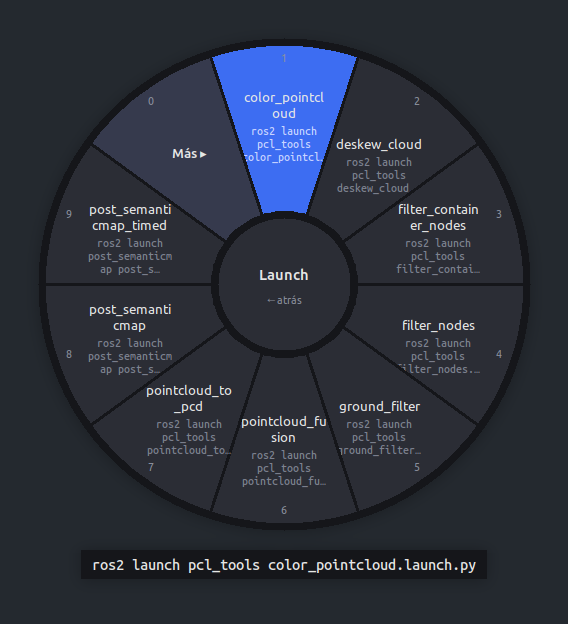
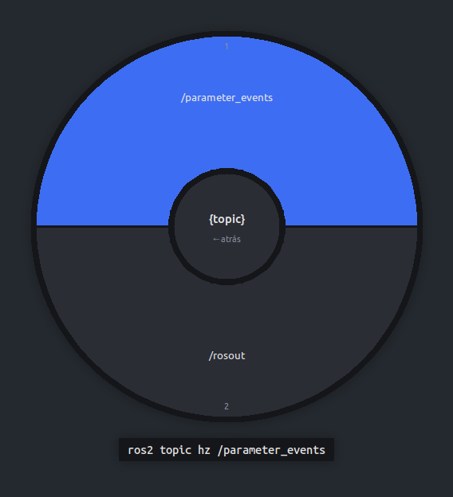
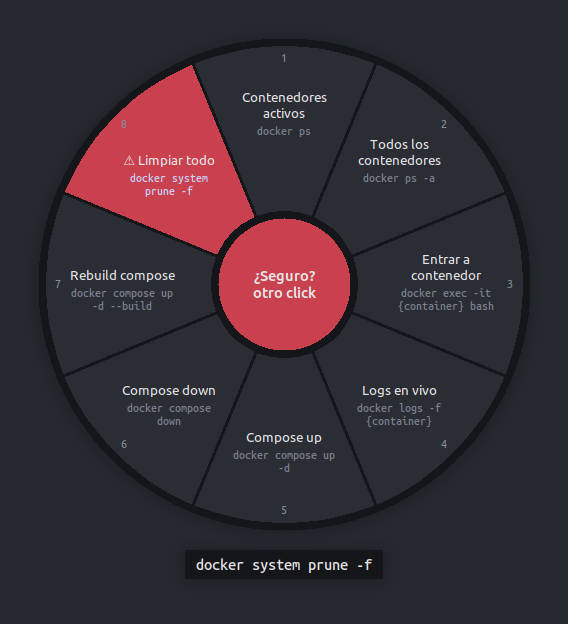
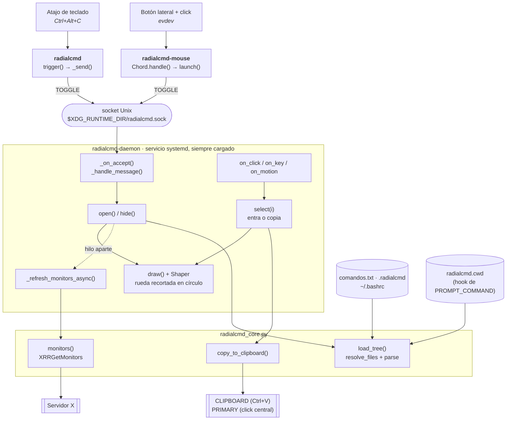

# radial-cmd

Menú radial para tener a mano los comandos que más usas al desarrollar, testear y depurar. Pulsas un atajo y aparece una rueda bajo el ratón. Eliges un comando con un click o una tecla y queda copiado, listo para pegarlo en la terminal.

<p align="center">
  
  
  
</p>

- **Rápido:** un servicio en segundo plano tiene la rueda ya cargada, así que aparece en unos 50 ms.
- **Categorías y subcategorías** en un archivo de texto plano que se relee en cada apertura.
- **Por proyecto:** un `.radialcmd` en la carpeta del proyecto se suma a tus comandos generales cuando trabajas en ella.
- **Workspaces de ROS 2 automáticos:** dentro de un workspace colcon aparece sola una categoría con `source`, build por paquete y sus launch files.
- **Huecos con opciones reales:** `ros2 topic hz {topic}` te ofrece los topics que hay ahora mismo; `{iface}`, `{container}`, `{pkg}`… igual.
- **Recientes, búsqueda escribiendo y aviso en comandos peligrosos.**
- **Copia a los dos portapapeles** (`Ctrl+V` y click central), o **pega directamente** con Shift+click.
- **Atajo de teclado** (`Ctrl+Alt+C` por defecto) y, opcionalmente, **combo de ratón**: botón lateral + click izquierdo.
- **Iconos PNG** en las categorías y **varios monitores**: la rueda sale bajo el puntero, en el monitor donde esté.

<p align="center">
  
  
  
</p>

Probado en Ubuntu 24.04 con GNOME sobre X11.

## Instalación

```bash
git clone https://github.com/danicannt/radial-cmd.git
cd radial-cmd
./install.sh
```

`install.sh` hace esto:

- instala las dependencias (`python3-tk`, `python3-pil`, `wl-clipboard`, `xclip`, `xdotool`);
- copia los scripts a `~/.local/bin`;
- añade a `~/.bashrc` una línea que apunta el directorio de la terminal en cada prompt (para los proyectos y workspaces);
- crea `~/.config/radialcmd/comandos.txt` a partir de [`comandos.example.txt`](comandos.example.txt), sin sobrescribirlo si ya existe;
- activa el servicio `radialcmd.service` de systemd para tu usuario;
- crea el atajo de GNOME `Ctrl+Alt+C`.

Para usar otro atajo, pásalo como argumento:

```bash
./install.sh '<Super>x'
```

### Combo de ratón (opcional)

Para abrir la rueda manteniendo el botón lateral de "adelante" (`BTN_EXTRA`) y haciendo click izquierdo. Vale en cualquier orden:

```bash
./install-mouse.sh
```

Te añade al grupo `input` para poder leer el ratón, así que la primera vez hay que cerrar sesión y volver a entrar. Para usar otro botón, mira su nombre con `radialcmd-mouse --detect` y pásalo como argumento:

```bash
./install-mouse.sh BTN_SIDE
./install-mouse.sh BTN_EXTRA none   # solo el botón lateral, sin click
```

El botón lateral pulsado solo sigue funcionando como siempre: "adelante" en el navegador, etc.

## Uso

| Acción | Ratón | Teclado |
|---|---|---|
| Elegir sector / entrar en categoría | click izquierdo | `1`–`9`, `0` |
| Copiar y pegar en la ventana activa | Shift+click | |
| Buscar en el anillo y sus subcategorías | | escribir letras; `Enter` = el primero |
| Volver atrás | click en el centro o botón derecho | `Backspace` |
| Cerrar | click fuera de la rueda | `Esc` (con búsqueda: la borra) o volver a pulsar el atajo |

Al elegir un comando, el centro muestra **✓ Copiado** y la rueda se cierra sola. Debajo de la rueda se ve el comando completo del sector que tienes bajo el ratón.

- **Recientes:** los últimos 8 comandos usados, ya rellenados, en su propio anillo (se guardan en `~/.local/state/radialcmd/`).
- **Más de 10 entradas:** las que no caben van a un sector **Más ▸**, para que todas tengan tecla.
- **Pegar con Shift+click:** en terminales manda `Ctrl+Shift+V` y en el resto `Ctrl+V`. Necesita `xdotool`.

### Línea de comandos

```bash
radialcmd            # abre o cierra la rueda (lo que ejecuta el atajo)
radialcmd -f otro.txt   # abre la rueda con otro archivo, solo esta vez
radialcmd --edit     # abre en el editor el archivo de comandos activo
radialcmd --which    # muestra qué archivos se están leyendo
radialcmd --status   # dice si el servicio está activo
radialcmd --hook     # añade a ~/.bashrc el aviso del directorio (si no lo hizo install.sh)
```

`--which` también dice qué directorio, proyecto y workspace se están usando.

## El archivo de comandos

Por defecto es `~/.config/radialcmd/comandos.txt`. Se relee en cada apertura, así que basta con guardar los cambios.

```ini
# comentario
[ROS 2]                                  # categoría: un anillo nuevo
Source Jazzy => source /opt/ros/jazzy/setup.bash
Topics => ros2 topic list

Hz de un topic => ros2 topic hz {topic}  # hueco: al elegirlo, se ofrecen los topics
! Build limpio => rm -rf build install log  # peligroso: en rojo, pide un segundo click

[Cámaras/Red]                            # subcategoría
MTU 9000 => sudo ip link set dev {iface} mtu 9000
Ping => ping -c 3 {ip}                   # hueco sin generador: se escribe en el centro

[]                                       # vuelve a la raíz
docker ps                                # sin "=>": la etiqueta es el propio comando
@topic = docker exec mi_contenedor bash -c 'source /opt/ros/humble/setup.bash && ros2 topic list'
```

- **`Etiqueta => comando`:** el comando puede llevar `|`, `&&`, comillas, etc.
- **Tamaño de los anillos:** queda mejor con 4–8 entradas por anillo; si crece, usa subcategorías.
- **Categorías repetidas:** se juntan, también entre archivos distintos.

### Huecos y generadores

Un `{nombre}` en minúsculas dentro de un comando es un hueco. Al elegir el comando se abre otro anillo con las opciones, eliges una y se copia el comando ya completo. Si hay varios huecos, se piden uno tras otro.

| Hueco | Opciones |
|---|---|
| `{topic}`, `{node}`, `{service}` | `ros2 topic list`, `ros2 node list`, `ros2 service list` |
| `{iface}` | interfaces de red (`ip -br link`) |
| `{container}` | contenedores en marcha (`docker ps`) |
| `{pkg}`, `{launch}` | paquetes y launch files del workspace detectado |
| cualquier otro | un campo de texto en el centro (`Enter` para aceptar) |

- **Generadores propios:** con `@nombre = comando` cada línea de la salida es una opción. También sirve para redefinir los de serie; por ejemplo, para listar los topics de dentro de un contenedor, como en el ejemplo de arriba.
- **Cuándo se ejecutan:** los generadores se lanzan en segundo plano nada más abrir la rueda, porque `ros2 topic list` tarda ~1 s. Mientras tanto, el anillo pone "cargando…". El resultado se reutiliza durante 30 s.
- **Qué no es un hueco:** `${VAR}`, `{a,b}` y `{{.Names}}` de Docker se dejan tal cual.

### Proyectos y workspaces

La línea que `install.sh` añade a `~/.bashrc` apunta el directorio de la terminal cada vez que pulsas Enter. Al abrir la rueda, se mira la última terminal usada:

- **Archivo `.radialcmd`:** si está en esa carpeta o en una superior, se suma a tus comandos generales, con el mismo formato. Así, cada proyecto tiene sus comandos y el centro de la rueda muestra el nombre del proyecto.
- **Workspace colcon:** si hay uno (una carpeta con `src/` e `install/`), aparece la categoría **ROS *nombre_ws***. Incluye `source` con la ruta absoluta, para pegarlo desde cualquier carpeta; build de todo o por paquete; y un anillo con los launch files (`ros2 launch paquete archivo`).

Con ROS dentro de un contenedor, la terminal del contenedor no avisa de su directorio. Abre la rueda desde una terminal del host que esté en el workspace.

### Varios archivos (comandos generales + proyecto)

Si en `~/.bashrc` defines `RADIALCMD_FILE` con varias rutas separadas por `:`, se combinan:

```bash
export RADIALCMD_FILE=~/.config/radialcmd/comandos.txt:~/mi_proyecto/comandos.txt
```

El servicio lee esa línea de `~/.bashrc` en cada apertura, sin reiniciar nada. Orden de prioridad: `-f` > variable de entorno > `~/.bashrc` > archivo por defecto.

### Iconos

Pon un PNG en `~/.config/radialcmd/icons/` con el nombre de una palabra. Aparecerá en todas las entradas cuya etiqueta contenga esa palabra:

```
~/.config/radialcmd/icons/ros.png      →  "ROS 2"
~/.config/radialcmd/icons/docker.png   →  "Docker"
```

Se reducen solos a 26 px de alto como máximo; mejor si tienen fondo transparente. Los iconos no se incluyen en el repositorio porque los logos de ROS y Docker son marcas registradas.

## Cómo funciona



1. **Disparo.** El atajo ejecuta `radialcmd`, que manda `TOGGLE` por el socket y termina sin cargar nada más (~20 ms). El combo de ratón lo detecta `radialcmd-mouse`, que reenvía todos los demás eventos a un ratón virtual (`uinput`) para que el ratón funcione como siempre.
2. **Servicio.** `radialcmd-daemon` tiene Tk y la ventana ya creados. Duerme sin gastar CPU hasta que el socket recibe algo.
3. **Apertura.** `open()` relee los archivos de comandos, coloca la rueda bajo el puntero y la dibuja antes de mostrarla. La ventana se recorta en círculo con la extensión Shape de X, sin capa a pantalla completa ni transparencias, para que el compositor la pinte al instante.
4. **Elección.** `select()` entra en la categoría o copia el comando con `xclip` / `wl-copy` a los dos portapapeles. Después, la rueda se cierra.

Si el servicio no está activo, `radialcmd` lo arranca él mismo la primera vez.

## Depuración

```bash
systemctl --user status radialcmd          # servicio de la rueda
systemctl --user status radialcmd-mouse    # servicio del combo de ratón
journalctl --user -u radialcmd-mouse -f    # qué ratones usa, desconexiones…
```

Para ver cuánto tarda cada paso de la apertura, para el servicio y lánzalo a mano con trazas de tiempo:

```bash
systemctl --user stop radialcmd
RADIALCMD_DEBUG_TIMING=1 ~/.local/bin/radialcmd-daemon
```

## Licencia

[MIT](LICENSE)
